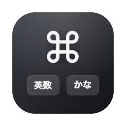
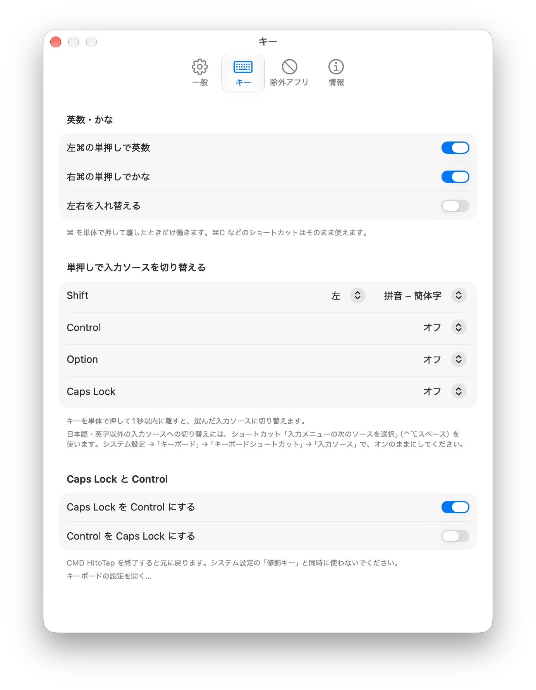

<p align="center">
  
</p>

<h1 align="center">CMD HitoTap</h1>

<p align="center">
  左の ⌘ だけを押すと英数、右の ⌘ だけを押すとかな。<br>
  US キーボードで日本語を打つための、小さなメニューバーアプリです。
</p>

<p align="center">
  <a href="https://github.com/clamclaw/cmdhitotap/releases/latest/download/CMD-HitoTap.dmg"><b>Mac 版をダウンロード</b></a>
  ·
  <a href="https://clamwake.com/ja/cmdhitotap/">Webサイト</a>
  ·
  Apple の公証済み · macOS 14 以降 · Apple シリコン · 無料
</p>

<p align="center">
  <a href="README.md">English</a> ·
  <b>日本語</b> ·
  <a href="README.ko.md">한국어</a> ·
  <a href="README.zh-Hans.md">简体中文</a> ·
  <a href="README.zh-Hant.md">繁體中文</a>
</p>

<p align="center">
  
</p>

---

JIS キーボードには、英字入力と日本語入力に直接切り替える「英数」「かな」キーがあります。US キーボードにはありません。CMD HitoTap は、左右の ⌘ キーの単押しを、この2つのキーに変えます。

## 機能

### 英数・かな（既定でオン）

| 押すキー | 結果 |
| --- | --- |
| 左 ⌘ だけ | 英数 |
| 右 ⌘ だけ | かな |
| ⌘ ＋ ほかのキー | ⌘C など、ふだんどおり |

- ⌘ だけを押して離し、その間にほかのキーやクリックがなかったときだけ切り替えます。
- 本物の英数・かなキーを送るので、JIS キーボードと同じように、打ち始めの1文字目から切り替わります。
- 左右それぞれオン・オフでき、左右を入れ替えることもできます。

### 単押しで入力ソースを切り替える（既定でオフ）

- **Shift・Option**：左・右・左右のどれで反応するかを選び、切り替え先の入力ソースを指定します。
- **Control・Caps Lock**：オンにして、切り替え先の入力ソースを指定します。
- 単押しとは、キーだけを押して1秒以内に離すことです。
- 英字・日本語以外（拼音・韓国語など）への切り替えには、macOS のショートカット「入力メニューの次のソースを選択」（⌃⌥スペース）を使います。システム設定 →「キーボード」→「キーボードショートカット」→「入力ソース」で、オンのままにしてください。切り替えの途中に打ったキーは、いったん預かり、順番どおりに送ります。

### Caps Lock と Control（既定でオフ）

- Caps Lock を Control に、Control を Caps Lock にできます。両方オンにすると入れ替えになります。
- システム設定の「修飾キー」と同じ仕組みを使います。CMD HitoTap を終了すると元に戻ります。システム設定の「修飾キー」とは一緒に使わないでください。

### そのほか

- **除外アプリ**：指定したアプリが前面にある間は切り替えません。
- **パスワード入力欄**：macOS のセキュア入力が有効な間は切り替えません。
- **ログイン時に起動**
- **5 言語**：英語・日本語・韓国語・中国語（簡体字・繁体字）

## 動作環境

- macOS 14 Sonoma 以降、Apple シリコンの Mac（Intel の Mac には対応していません）

## 入れ方

1. [CMD-HitoTap.dmg](https://github.com/clamclaw/cmdhitotap/releases/latest/download/CMD-HitoTap.dmg) をダウンロードして開き、CMD HitoTap を「アプリケーション」にドラッグします。
2. CMD HitoTap を開きます。許可を何に使うかを説明する窓が出るので、「続ける」を押します。
3. システム設定 →「プライバシーとセキュリティ」→「アクセシビリティ」（macOS 27 では「デバイスの制御とデータへのアクセス」）で、CMD HitoTap をオンにします。一覧にないときは、「+」から追加するか、Finder から引き込みます。
4. メニューバーのアイコンが「⌘」になれば準備完了です。許可が足りない間は「⌘!」になります。

1 の代わりに、[Homebrew](https://brew.sh) でも入れられます（2 からは同じです）。

```bash
brew install --cask clamclaw/tap/cmdhitotap
```

## 許可

| 許可 | 使い道 |
| --- | --- |
| **アクセシビリティ**（macOS 27 では「デバイスの制御とデータへのアクセス」） | キーの動きを見て、⌘ の単押しとショートカットを見分けるため。英数・かなキーを送るため。 |

## プライバシー

- キーの動きは Mac の中のメモリだけで扱います。打った内容を記録・保存・送信しません。
- CMD HitoTap がインターネットにつながるのは、アップデートの確認（1日1回、GitHub へ）のときだけです。データを集めず、分析の仕組みも入っていません。
- アプリは Developer ID で署名し、Apple の公証を受けています。Apple がマルウェアなどの悪意あるソフトウェアの検査をして、確認したアプリです。
- 詳しくは[プライバシーポリシー](https://clamwake.com/ja/cmdhitotap/privacy/)をご覧ください。

## アップデート

CMD HitoTap は1日1回、新しいバージョンがあるかを確認し、打っている最中を邪魔しないよう、メニューの「アップデートがあります…」で知らせます。メニューの「アップデートを確認…」からも確認できます。毎日の確認を止めるときは、設定 →「一般」の「アップデートを自動で確認」をオフにします。

## 知っておくと便利なこと

- Caps Lock や Control を置き換えている最中に CMD HitoTap が異常終了した場合、置き換えは次に開いたときに元に戻ります。すぐに戻すときは、ターミナルで次を実行します。
  ```bash
  hidutil property --set '{"UserKeyMapping":[]}'
  ```
  `hidutil` で自分で入れた置き換えも消えます。

## アンインストール

1. メニューから CMD HitoTap を終了します。
2. `CMD HitoTap.app` をゴミ箱に入れます。
3. 設定も消すときは、ターミナルで次を実行します。
   ```bash
   defaults delete com.clamwake.cmdhitotap
   ```

## ご意見・不具合の報告

不具合を見つけたり、アイデアがあったりしたら、[Issue を作成](https://github.com/clamclaw/cmdhitotap/issues)してください。

このリポジトリには、説明書き・ダウンロード・Issue があります。アプリのソースコードは公開していません。
