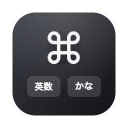
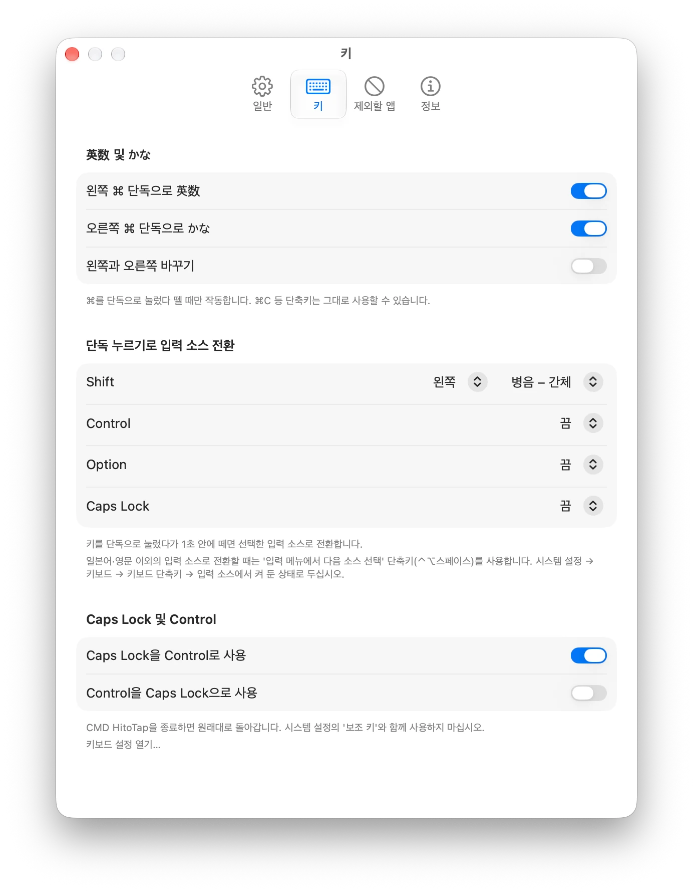

<p align="center">
  
</p>

<h1 align="center">CMD HitoTap</h1>

<p align="center">
  왼쪽 ⌘만 누르면 英数(영숫자), 오른쪽 ⌘만 누르면 かな(가나).<br>
  US 키보드로 일본어를 입력하기 위한 작은 메뉴 막대 앱입니다.
</p>

<p align="center">
  <a href="https://github.com/clamclaw/cmdhitotap/releases/latest/download/CMD-HitoTap.dmg"><b>Mac용 다운로드</b></a>
  ·
  <a href="https://clamwake.com/ko/cmdhitotap/">웹사이트</a>
  ·
  Apple 공증 완료 · macOS 14 이상 · Apple 실리콘 · 무료
</p>

<p align="center">
  <a href="README.md">English</a> ·
  <a href="README.ja.md">日本語</a> ·
  <b>한국어</b> ·
  <a href="README.zh-Hans.md">简体中文</a> ·
  <a href="README.zh-Hant.md">繁體中文</a>
</p>

<p align="center">
  
</p>

---

일본어(JIS) 키보드에는 영문 입력과 일본어 입력으로 바로 전환하는 英数 키와 かな 키가 있습니다. US 키보드에는 없습니다. CMD HitoTap은 왼쪽과 오른쪽 ⌘ 키를 단독으로 누르는 동작을 이 두 키로 바꿉니다.

## 기능

### 英数와 かな (기본값: 켬)

| 누르는 키 | 결과 |
| --- | --- |
| 왼쪽 ⌘만 | 英数 (영문) |
| 오른쪽 ⌘만 | かな (일본어) |
| ⌘ + 다른 키 | ⌘C 등 평소대로 작동 |

- ⌘만 눌렀다 떼고, 그 사이에 다른 키나 클릭이 없을 때만 전환합니다.
- 실제 英数·かな 키를 보내므로, 일본어 키보드와 똑같이 입력하는 첫 글자부터 전환됩니다.
- 왼쪽과 오른쪽을 각각 켜거나 끌 수 있고, 서로 바꿀 수도 있습니다.

### 단독 누르기로 입력 소스 전환 (기본값: 끔)

- **Shift·Option**: 왼쪽, 오른쪽, 양쪽 중 반응할 키를 고르고, 전환할 입력 소스를 지정합니다.
- **Control·Caps Lock**: 켜고 전환할 입력 소스를 지정합니다.
- 단독 누르기란 그 키만 눌러서 1초 이내에 떼는 것을 말합니다.
- 영문·일본어 이외의 입력 소스(병음, 한국어 등)로 전환할 때는 macOS 단축키 '입력 메뉴에서 다음 소스 선택'(⌃⌥스페이스)을 사용합니다. 시스템 설정 → 키보드 → 키보드 단축키 → 입력 소스에서 켜 둔 상태로 두십시오. 전환하는 동안 입력한 키는 잠시 보관했다가 순서대로 보냅니다.

### Caps Lock과 Control (기본값: 끔)

- Caps Lock을 Control로, Control을 Caps Lock으로 사용할 수 있습니다. 둘 다 켜면 서로 바뀝니다.
- 시스템 설정의 '보조 키'와 같은 방식을 사용합니다. CMD HitoTap을 종료하면 원래대로 돌아갑니다. 시스템 설정의 '보조 키'와 함께 사용하지 마십시오.

### 그 밖의 기능

- **제외할 앱**: 지정한 앱이 앞에 있는 동안에는 전환하지 않습니다.
- **암호 입력란**: macOS의 보안 입력이 켜져 있는 동안에는 전환하지 않습니다.
- **로그인 시 실행**
- **5개 언어**: 영어, 일본어, 한국어, 중국어(간체·번체)

## 시스템 요구 사항

- macOS 14 Sonoma 이상, Apple 실리콘 Mac (Intel Mac은 지원하지 않습니다)

## 설치

1. [CMD-HitoTap.dmg](https://github.com/clamclaw/cmdhitotap/releases/latest/download/CMD-HitoTap.dmg)를 다운로드해 열고, CMD HitoTap을 '응용 프로그램'으로 드래그합니다.
2. CMD HitoTap을 엽니다. 권한을 어디에 쓰는지 설명하는 창이 나타나면 '계속'을 클릭합니다.
3. 시스템 설정 → 개인정보 보호 및 보안 → 손쉬운 사용(macOS 27에서는 '기기 제어 및 데이터 접근')에서 CMD HitoTap을 켭니다. 목록에 없으면 '+' 버튼으로 추가하거나 Finder에서 끌어다 놓습니다.
4. 메뉴 막대 아이콘이 '⌘'가 되면 준비가 끝난 것입니다. 권한이 없는 동안에는 '⌘!'로 표시됩니다.

1 대신 [Homebrew](https://brew.sh)로도 설치할 수 있습니다(2부터는 같습니다).

```bash
brew install --cask clamclaw/tap/cmdhitotap
```

## 권한

| 권한 | 용도 |
| --- | --- |
| **손쉬운 사용** (macOS 27에서는 '기기 제어 및 데이터 접근') | 키 입력을 보고 ⌘ 단독 누르기와 단축키를 구별하기 위해. 英数·かな 키를 보내기 위해. |

## 개인정보 보호

- 키 입력은 Mac 안의 메모리에서만 처리합니다. 입력한 내용을 기록, 저장, 전송하지 않습니다.
- CMD HitoTap은 업데이트를 확인할 때(하루에 한 번, GitHub)만 인터넷에 연결합니다. 데이터를 수집하지 않으며, 분석 도구도 들어 있지 않습니다.
- 앱은 Developer ID로 서명되었고 Apple의 공증을 받았습니다. Apple이 악성 소프트웨어가 있는지 검사했습니다.
- 자세한 내용은 [개인정보 처리방침](https://clamwake.com/ko/cmdhitotap/privacy/)을 참고하십시오.

## 업데이트

CMD HitoTap은 하루에 한 번 새 버전이 있는지 확인하고, 입력을 방해하지 않도록 메뉴의 '업데이트 가능…'으로 알려 줍니다. 메뉴의 '업데이트 확인…'으로 직접 확인할 수도 있습니다. 매일 확인하지 않으려면 설정 → 일반에서 '자동으로 업데이트 확인'을 끕니다.

## 알아 두면 좋은 점

- Caps Lock이나 Control을 바꿔 둔 상태에서 CMD HitoTap이 비정상 종료되면, 다음에 열 때 원래대로 돌아갑니다. 바로 되돌리려면 터미널에서 다음을 실행합니다.
  ```bash
  hidutil property --set '{"UserKeyMapping":[]}'
  ```
  `hidutil`로 직접 설정한 키 바꾸기도 함께 지워집니다.

## 제거

1. 메뉴에서 CMD HitoTap을 종료합니다.
2. `CMD HitoTap.app`을 휴지통으로 옮깁니다.
3. 설정도 지우려면 터미널에서 다음을 실행합니다.
   ```bash
   defaults delete com.clamwake.cmdhitotap
   ```

## 의견 보내기

버그를 발견했거나 아이디어가 있으면 [Issue를 만들어 주십시오](https://github.com/clamclaw/cmdhitotap/issues).

이 저장소에는 설명서, 다운로드, Issue가 있습니다. 앱의 소스 코드는 공개하지 않습니다.
