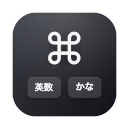
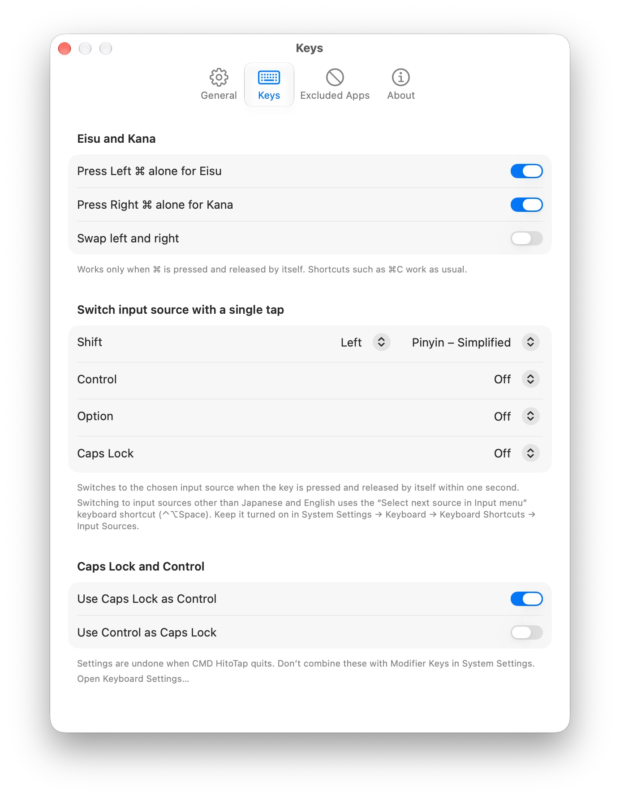

<p align="center">
  
</p>

<h1 align="center">CMD HitoTap</h1>

<p align="center">
  Press the left ⌘ alone for Eisu (English) and the right ⌘ alone for Kana (Japanese).<br>
  A small menu bar app for typing Japanese on a US keyboard.
</p>

<p align="center">
  <a href="https://github.com/clamclaw/cmdhitotap/releases/latest/download/CMD-HitoTap.dmg"><b>Download for Mac</b></a>
  ·
  <a href="https://clamwake.com/cmdhitotap/">Website</a>
  ·
  Notarized by Apple · macOS 14 or later · Apple silicon · Free
</p>

<p align="center">
  <b>English</b> ·
  <a href="README.ja.md">日本語</a> ·
  <a href="README.ko.md">한국어</a> ·
  <a href="README.zh-Hans.md">简体中文</a> ·
  <a href="README.zh-Hant.md">繁體中文</a>
</p>

<p align="center">
  
</p>

---

Japanese keyboards have Eisu and Kana keys that switch straight to English or Japanese input. US keyboards don't. CMD HitoTap turns a single press of the left and right Command keys into those two keys.

## Features

### Eisu and Kana (on by default)

| Press | Result |
| --- | --- |
| Left ⌘ alone | Eisu (English) |
| Right ⌘ alone | Kana (Japanese) |
| ⌘ with another key | Works as usual, for example ⌘C |

- It switches only when ⌘ is pressed and released by itself, without any other key or click in between.
- CMD HitoTap sends the real Eisu and Kana keys, so input switches exactly as it does on a Japanese keyboard, starting with the first character you type.
- You can turn each side on or off, and swap left and right.

### Switch input source with a single tap (off by default)

- **Shift and Option:** choose the left key, the right key or both, and pick an input source to switch to.
- **Control and Caps Lock:** turn on and pick an input source.
- A single tap means pressing and releasing the key by itself within one second.
- Switching to input sources other than English and Japanese (such as Pinyin or Korean) uses the macOS shortcut “Select next source in Input menu” (⌃⌥Space). Keep it turned on in System Settings → Keyboard → Keyboard Shortcuts → Input Sources. Keys you type while switching are held and then sent in order.

### Caps Lock and Control (off by default)

- Use Caps Lock as Control, and use Control as Caps Lock. Turn on both to swap them.
- This uses the same mechanism as Modifier Keys in System Settings. The original setting comes back when CMD HitoTap quits. Don't use it together with Modifier Keys in System Settings.

### Also

- **Excluded apps:** no switching while a chosen app is in front.
- **Password fields:** while macOS secure input is on, CMD HitoTap doesn't switch.
- **Launch at login.**
- **5 languages:** English, Japanese, Korean, and Chinese (Simplified and Traditional).

## Requirements

- macOS 14 Sonoma or later, on Apple silicon (Intel Macs aren't supported).

## Install

1. Download [CMD-HitoTap.dmg](https://github.com/clamclaw/cmdhitotap/releases/latest/download/CMD-HitoTap.dmg), open it, and drag CMD HitoTap to Applications.
2. Open CMD HitoTap. A window explains what the permission is used for. Click “Continue”.
3. Turn on CMD HitoTap in System Settings → Privacy & Security → Accessibility (“Device Control and Data Access” on macOS 27). If CMD HitoTap isn't in the list, add it with the “+” button or drag it in from the Finder.
4. When the menu bar icon shows “⌘”, it's ready. It shows “⌘!” while the permission is missing.

Instead of step 1, you can also install with [Homebrew](https://brew.sh) (the other steps are the same):

```bash
brew install --cask clamclaw/tap/cmdhitotap
```

## Permission

| Permission | What it is used for |
| --- | --- |
| **Accessibility** (“Device Control and Data Access” on macOS 27) | To see key presses so that a single press of ⌘ can be told apart from a shortcut, and to send the Eisu and Kana keys. |

## Privacy

- Key presses are handled in memory only, on your Mac. CMD HitoTap doesn't record, store or send what you type.
- CMD HitoTap connects to the internet only to check for updates (once a day, from GitHub). It collects no data and contains no analytics.
- The app is signed with a Developer ID and notarized by Apple: Apple has checked it for malicious software.
- See the [privacy policy](https://clamwake.com/cmdhitotap/privacy/) for details.

## Updates

CMD HitoTap checks for a new version once a day and lets you know from its menu (“Update Available…”) without interrupting your typing. You can also choose “Check for Updates…” from the menu. To stop the daily check, turn off “Check for updates automatically” in Settings → General.

## Good to know

- If CMD HitoTap quit unexpectedly while Caps Lock or Control was replaced, the replacement is undone the next time you open it. To undo it right away, run this in Terminal:
  ```bash
  hidutil property --set '{"UserKeyMapping":[]}'
  ```
  This also clears replacements you set yourself with `hidutil`.

## Uninstall

1. Quit CMD HitoTap from its menu.
2. Move `CMD HitoTap.app` to the Trash.
3. To remove its settings as well, run this in Terminal:
   ```bash
   defaults delete com.clamwake.cmdhitotap
   ```

## Feedback

Found a bug or have an idea? Please [open an issue](https://github.com/clamclaw/cmdhitotap/issues).

This repository holds the documentation, the downloads and the issue tracker. The app itself is closed source.
