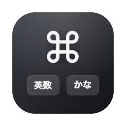
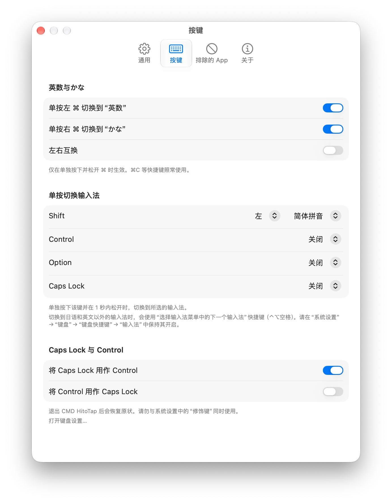

<p align="center">
  
</p>

<h1 align="center">CMD HitoTap</h1>

<p align="center">
  单按左 ⌘ 切换到“英数”（英文），单按右 ⌘ 切换到“かな”（日文）。<br>
  在美式键盘上输入日语的小巧菜单栏 App。
</p>

<p align="center">
  <a href="https://github.com/clamclaw/cmdhitotap/releases/latest/download/CMD-HitoTap.dmg"><b>下载 Mac 版</b></a>
  ·
  <a href="https://clamwake.com/zh-hans/cmdhitotap/">网站</a>
  ·
  已通过 Apple 公证 · macOS 14 或更高版本 · Apple 芯片 · 免费
</p>

<p align="center">
  <a href="README.md">English</a> ·
  <a href="README.ja.md">日本語</a> ·
  <a href="README.ko.md">한국어</a> ·
  <b>简体中文</b> ·
  <a href="README.zh-Hant.md">繁體中文</a>
</p>

<p align="center">
  
</p>

---

日文（JIS）键盘上有“英数”和“かな”两个键，可以直接切换到英文输入和日文输入。美式键盘上没有这两个键。CMD HitoTap 把单按左右 ⌘ 键变成这两个键。

## 功能

### 英数与かな（默认开启）

| 按键 | 结果 |
| --- | --- |
| 单按左 ⌘ | 英数（英文） |
| 单按右 ⌘ | かな（日文） |
| ⌘ + 其他键 | 照常使用，例如 ⌘C |

- 只有单独按下并松开 ⌘，且中间没有按其他键或点按时，才会切换。
- CMD HitoTap 发送真正的“英数”和“かな”键，因此切换方式与日文键盘完全相同，从输入的第一个字符起就已切换。
- 左右可以分别开启或关闭，也可以左右互换。

### 单按切换输入法（默认关闭）

- **Shift 与 Option**：选择左键、右键或两侧，并指定要切换到的输入法。
- **Control 与 Caps Lock**：开启后指定要切换到的输入法。
- 单按是指只按下该键并在一秒内松开。
- 切换到英文和日语以外的输入法（例如拼音或韩语）时，会使用 macOS 的快捷键“选择输入法菜单中的下一个输入法”（⌃⌥空格）。请在“系统设置”→“键盘”→“键盘快捷键”→“输入法”中保持其开启。切换过程中输入的按键会先暂存，再按顺序发送。

### Caps Lock 与 Control（默认关闭）

- 可以将 Caps Lock 用作 Control，将 Control 用作 Caps Lock。两项都开启即可互换。
- 使用与“系统设置”中“修饰键”相同的机制。退出 CMD HitoTap 后会恢复原样。请不要与“系统设置”中的“修饰键”同时使用。

### 其他

- **排除的 App**：指定的 App 位于最前面时不切换。
- **密码输入框**：macOS 的安全输入开启时不切换。
- **登录时启动**
- **5 种语言**：英语、日语、韩语、中文（简体与繁体）

## 系统要求

- macOS 14 Sonoma 或更高版本，搭载 Apple 芯片的 Mac（不支持 Intel 芯片的 Mac）

## 安装

1. 下载 [CMD-HitoTap.dmg](https://github.com/clamclaw/cmdhitotap/releases/latest/download/CMD-HitoTap.dmg) 并打开，将 CMD HitoTap 拖到“应用程序”。
2. 打开 CMD HitoTap。会出现说明权限用途的窗口，点按“继续”。
3. 在“系统设置”→“隐私与安全性”→“辅助功能”（macOS 27 中为“设备控制和数据访问”）中打开 CMD HitoTap。如果列表中没有 CMD HitoTap，请用“+”按钮添加，或从访达拖进来。
4. 菜单栏图标变为“⌘”即表示准备就绪。缺少权限时显示“⌘!”。

也可以用 [Homebrew](https://brew.sh) 安装来代替第 1 步（第 2 步起相同）：

```bash
brew install --cask clamclaw/tap/cmdhitotap
```

## 权限

| 权限 | 用途 |
| --- | --- |
| **辅助功能**（macOS 27 中为“设备控制和数据访问”） | 查看按键，以区分单按 ⌘ 与快捷键；发送“英数”和“かな”键。 |

## 隐私

- 按键只在 Mac 的内存中处理。CMD HitoTap 不会记录、存储或发送你输入的内容。
- CMD HitoTap 仅在检查更新时（每天一次，从 GitHub）连接互联网，不收集任何数据，也不含分析工具。
- App 已使用 Developer ID 签名，并经过 Apple 公证：Apple 已检查它是否含有恶意软件。
- 详情请参阅[隐私政策](https://clamwake.com/zh-hans/cmdhitotap/privacy/)。

## 更新

CMD HitoTap 每天检查一次是否有新版本，并通过菜单中的“有可用更新…”提醒你，不会打断你的输入。也可以从菜单选择“检查更新…”。如需停止每天检查，请在“设置”→“通用”中关闭“自动检查更新”。

## 小提示

- 如果在替换 Caps Lock 或 Control 期间 CMD HitoTap 意外退出，下次打开时会恢复原样。如需立即恢复，请在终端中运行：
  ```bash
  hidutil property --set '{"UserKeyMapping":[]}'
  ```
  这也会清除你自己用 `hidutil` 设置的按键替换。

## 卸载

1. 从菜单退出 CMD HitoTap。
2. 将 `CMD HitoTap.app` 移到废纸篓。
3. 如需同时删除设置，请在终端中运行：
   ```bash
   defaults delete com.clamwake.cmdhitotap
   ```

## 反馈

发现问题或有想法？请[提交 Issue](https://github.com/clamclaw/cmdhitotap/issues)。

本仓库包含说明文档、下载和 Issue。App 的源代码不公开，但已使用 Developer ID 签名，并经过 Apple 公证（恶意软件检查）。App 不会记录、存储或发送你输入的内容，详见[隐私政策](https://clamwake.com/zh-hans/cmdhitotap/privacy/)。
