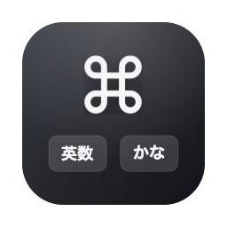
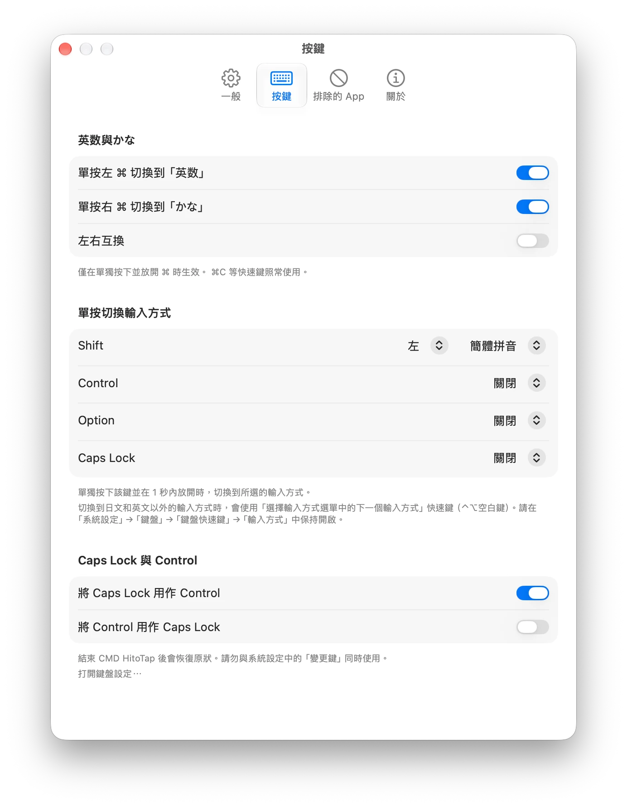

<p align="center">
  
</p>

<h1 align="center">CMD HitoTap</h1>

<p align="center">
  單按左 ⌘ 切換到「英数」（英文），單按右 ⌘ 切換到「かな」（日文）。<br>
  在美式鍵盤上輸入日文的小巧選單列 App。
</p>

<p align="center">
  <a href="https://github.com/clamclaw/cmdhitotap/releases/latest/download/CMD-HitoTap.dmg"><b>下載 Mac 版</b></a>
  ·
  <a href="https://clamwake.com/zh-hant/cmdhitotap/">網站</a>
  ·
  已通過 Apple 公證 · macOS 14 或以上版本 · Apple 晶片 · 免費
</p>

<p align="center">
  <a href="README.md">English</a> ·
  <a href="README.ja.md">日本語</a> ·
  <a href="README.ko.md">한국어</a> ·
  <a href="README.zh-Hans.md">简体中文</a> ·
  <b>繁體中文</b>
</p>

<p align="center">
  
</p>

---

日文（JIS）鍵盤上有「英数」和「かな」兩個鍵，可以直接切換到英文輸入和日文輸入。美式鍵盤上沒有這兩個鍵。CMD HitoTap 把單按左右 ⌘ 鍵變成這兩個鍵。

## 功能

### 英数與かな（預設開啟）

| 按鍵 | 結果 |
| --- | --- |
| 單按左 ⌘ | 英数（英文） |
| 單按右 ⌘ | かな（日文） |
| ⌘ + 其他鍵 | 照常使用，例如 ⌘C |

- 只有單獨按下並放開 ⌘，且中間沒有按其他鍵或按一下時，才會切換。
- CMD HitoTap 傳送真正的「英数」和「かな」鍵，因此切換方式與日文鍵盤完全相同，從輸入的第一個字元起就已切換。
- 左右可以分別開啟或關閉，也可以左右互換。

### 單按切換輸入方式（預設關閉）

- **Shift 與 Option**：選擇左鍵、右鍵或兩側，並指定要切換到的輸入方式。
- **Control 與 Caps Lock**：開啟後指定要切換到的輸入方式。
- 單按是指只按下該鍵並在一秒內放開。
- 切換到英文和日文以外的輸入方式（例如拼音或韓文）時，會使用 macOS 的快速鍵「選擇輸入方式選單中的下一個輸入方式」（⌃⌥空白鍵）。請在「系統設定」→「鍵盤」→「鍵盤快速鍵」→「輸入方式」中保持開啟。切換過程中輸入的按鍵會先暫存，再依序傳送。

### Caps Lock 與 Control（預設關閉）

- 可以將 Caps Lock 用作 Control，將 Control 用作 Caps Lock。兩項都開啟即可互換。
- 使用與「系統設定」中「變更鍵」相同的機制。結束 CMD HitoTap 後會恢復原狀。請不要與「系統設定」中的「變更鍵」同時使用。

### 其他

- **排除的 App**：指定的 App 位於最前方時不切換。
- **密碼輸入欄位**：macOS 的安全輸入開啟時不切換。
- **登入時啟動**
- **5 種語言**：英文、日文、韓文、中文（簡體與繁體）

## 系統需求

- macOS 14 Sonoma 或以上版本，搭載 Apple 晶片的 Mac（不支援 Intel 晶片的 Mac）

## 安裝

1. 下載 [CMD-HitoTap.dmg](https://github.com/clamclaw/cmdhitotap/releases/latest/download/CMD-HitoTap.dmg) 並打開，將 CMD HitoTap 拖到「應用程式」。
2. 打開 CMD HitoTap。會出現說明權限用途的視窗，按一下「繼續」。
3. 在「系統設定」→「隱私權與安全性」→「輔助使用」（macOS 27 中為「裝置控制和資料取用」）中開啟 CMD HitoTap。如果列表中沒有 CMD HitoTap，請用「+」按鈕加入，或從 Finder 拖進來。
4. 選單列圖像變為「⌘」即表示準備就緒。缺少權限時顯示「⌘!」。

也可以用 [Homebrew](https://brew.sh) 安裝來取代第 1 步（第 2 步起相同）：

```bash
brew install --cask clamclaw/tap/cmdhitotap
```

## 權限

| 權限 | 用途 |
| --- | --- |
| **輔助使用**（macOS 27 中為「裝置控制和資料取用」） | 查看按鍵，以區分單按 ⌘ 與快速鍵；傳送「英数」和「かな」鍵。 |

## 隱私權

- 按鍵只在 Mac 的記憶體中處理。CMD HitoTap 不會記錄、儲存或傳送你輸入的內容。
- CMD HitoTap 僅在檢查更新項目時（每天一次，從 GitHub）連接網際網路，不收集任何資料，也不含分析工具。
- App 已使用 Developer ID 簽署，並經過 Apple 公證：Apple 已檢查它是否含有惡意軟體。
- 詳情請參閱[隱私權政策](https://clamwake.com/zh-hant/cmdhitotap/privacy/)。

## 更新

CMD HitoTap 每天檢查一次是否有新版本，並透過選單中的「有可用的更新項目⋯」提醒你，不會打斷你的輸入。也可以從選單選擇「檢查更新項目⋯」。如需停止每天檢查，請在「設定」→「一般」中關閉「自動檢查更新項目」。

## 小提示

- 如果在替換 Caps Lock 或 Control 期間 CMD HitoTap 意外結束，下次打開時會恢復原狀。如需立即恢復，請在終端機中執行：
  ```bash
  hidutil property --set '{"UserKeyMapping":[]}'
  ```
  這也會清除你自己用 `hidutil` 設定的按鍵替換。

## 解除安裝

1. 從選單結束 CMD HitoTap。
2. 將 `CMD HitoTap.app` 移到垃圾桶。
3. 如需同時刪除設定，請在終端機中執行：
   ```bash
   defaults delete com.clamwake.cmdhitotap
   ```

## 意見回饋

發現問題或有想法？請[提交 Issue](https://github.com/clamclaw/cmdhitotap/issues)。

本儲存庫包含說明文件、下載和 Issue。App 的原始碼不公開，但已使用 Developer ID 簽署，並經過 Apple 公證（惡意軟體檢查）。App 不會記錄、儲存或傳送你輸入的內容，詳見[隱私權政策](https://clamwake.com/zh-hant/cmdhitotap/privacy/)。
